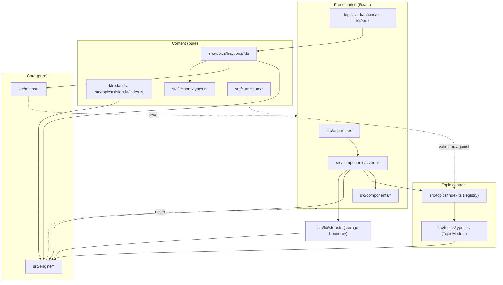

# ARCH-001 — Modular learning architecture

| | |
|---|---|
| **Backlog item** | ARCH-001: define the modular learning architecture (P0, R0) |
| **Status** | QA FAILED at `6050e3c` (D-014); corrected on 5 Nov and returned for independent retest (D-022) |
| **Date** | 4 November 2026; corrected 5 November 2026 ([correction report](../reports/R0-step2-correction-report.md)) |
| **Code described** | Branch `claude/pensive-pasteur-bs5979`; app code identical to `main` at `bbf210a` |
| **Acceptance criteria** | <ol><li>Presentation, lesson content, question definitions, mathematical logic, validation, progress, assessment and feedback are separated.</li><li>The architecture supports adding Tables and Mental Maths without rewriting the Fractions engine.</li></ol> |

This document describes the architecture **as built**, the **rules** that keep it modular (enforced by
`src/architecture.test.ts`), the **known coupling** to remove in R1, and **where Times Tables (R2) and Mental Maths
(R3) plug in**. No application code was changed for this item (D-012).

---

## 1. Layers

Each concern sits in its own layer. "Pure" means: no React, no Next.js, no browser APIs and no UI imports. A pure
module can run in a unit test or on a server without a page.

| Concern | Responsibility | Where it lives | Pure? | Rule enforced by |
|---|---|---|---|---|
| **Presentation** | Screens, navigation, layout, input controls, pictures | `src/app/**` (routes), `src/components/**`, `src/topics/*/ui/*`, `src/topics/kit/*.tsx`, `src/topics/{ActiveTopic,context}.tsx`, and `src/topics/fractions/module.tsx` (the composition root that binds Fractions content to its UI) | No (UI) | — |
| **Lesson content** | Lessons, steps, objectives, phases | `src/lessons/types.ts` (the schema), `src/topics/fractions/lessons.ts`, the `lessons` array in each `src/topics/<island>/index.ts` | Yes | `architecture.test.ts`, rules A3 and A4 |
| **Question definitions** | Questions, generators, options and traps, misconception tags, assessment forms | `src/topics/fractions/{questions,generate,misconceptions,placement}.ts`, kit `templates` in each island | Yes for Fractions; kit islands ⚠ (§4) | A3, plus allowlist A6 |
| **Mathematical logic** | Exact fraction arithmetic, equivalence, comparison, partitions | `src/maths/fraction.ts` (re-exported by `src/topics/fractions/math.ts`) | Yes | A2 |
| **Validation** (marking) | Is an answer right; which misconception it suggests; input problems | `src/topics/fractions/{evaluate,diagnose}.ts`, `src/topics/kit/evaluate.ts` | Yes | A3 |
| **Validation** (content integrity) | Is a question definition well-formed and correct | Today, test time only (`content.test.ts`, `kit.test.ts`). Runtime validation is **ARCH-002** (sprint step 3). | — | — |
| **Progress** | Versioned learner state, recording results, per-island progress | `src/engine/progress.ts` (pure), `src/lib/store.ts` (browser storage and React hooks), `src/lib/migrate.ts` | `progress` and `migrate` yes; `store` is the boundary | A1 |
| **Assessment and mastery** | Evidence rules, skill status, mastery, independent checks, rechecks | `src/engine/mastery.ts`, `src/engine/journey.ts`, the topic's `AssessmentKit`; `independentResults()` and `recheckPlan()` currently sit in screens ⚠ (§4) | Engine yes | A1 |
| **Feedback** | Hint → diagnosis → follow-up → retry → reveal state machine; misconception reports | `src/engine/recovery.ts`, `src/engine/mastery.ts` (`misconceptionReports`) | Yes | A1 |
| **Adaptivity** | Choosing the next practice question | `src/engine/adaptive.ts`, `src/engine/random.ts` (seeded) | Yes | A1 |
| **Rewards** | Stars, levels, streaks, badges, all derived from history | `src/engine/rewards.ts` | Yes | A1 |
| **Curriculum structure** | Worlds, islands, and (new) the prerequisite graph | `src/topics/worlds.ts` ⚠, `src/curriculum/prerequisites.ts` (CUR-002, pure data) | Curriculum yes | A5 |

## 2. Dependency rules



The rules below are **checked automatically** by `src/architecture.test.ts`, which runs with `npm test`. The project's CI
workflow runs on pull requests and on pushes to `main`. It has not run on the development branch (D-014).

**How the check works** (rebuilt on 5 Nov after the independent review found false negatives, DEF-023):
- **Real parsing.** `src/architecture/analyse.ts` parses code with the TypeScript compiler, so comments and strings are
  never treated as code.
- **Real resolution.** It resolves every dependency with the project's own `tsconfig` module resolution: relative paths,
  `../` traversal and the `@/` alias.
- **Every import form.** It covers:
  - static imports, including side-effect and type-only imports;
  - `export … from`;
  - `import x = require()`;
  - `import()`, including in type positions;
  - `require()`.
- **No unchecked names.** An unresolved relative or `@/` import fails. So does an `import()` or `require()` whose
  module name isn't a literal, because a static check can't follow it.
- **Browser and network globals.** It finds uses of an explicit list of prohibited globals: `window`, `document`,
  `localStorage`, `sessionStorage`, `navigator`, `indexedDB`, `fetch`, `XMLHttpRequest`, `matchMedia`,
  `requestAnimationFrame`, `location` and `history`.
  - These are caught directly and through `globalThis`, `window` or `self`, including `globalThis["…"]` and computed
    `globalThis[name]`.
  - The type checker resolves each name in its own scope. A local variable called `document` is not a global use,
    but a real global use elsewhere in the same file is.
  - A name counts as global when it is declared outside the project's own source. That covers DOM typings and Node
    typings (Node's `fetch`).
  - Standard APIs such as `Math` and `Number` are never on the list.
- **The global object escaping (DEF-030).** `globalThis` and `self` may only appear as the object of a property or
  element access. Destructuring (`const { localStorage: store } = globalThis`), aliases (`const g = globalThis`),
  arguments (`Reflect.get(globalThis, name)`) and spreads hide which capability is used, so they fail. The message names
  the captured capability when the pattern lists it. A local variable or parameter that shadows the name is not the
  global object, and destructuring `document` from an ordinary object is fine. `typeof globalThis` in a type is not a use.
- **A dependency matrix (DEF-031).** Each protected layer may import only the layers in its row. The **type-only column
  lists additional layers** allowed as types only. A type-only import may go to the runtime column ∪ the type-only column,
  so a same-layer type import is always allowed wherever a same-layer import is.

  | Layer | Runtime imports | Additional type-only imports |
  |---|---|---|
  | engine | engine | none |
  | maths | maths | none |
  | lessons | lessons | engine |
  | curriculum | curriculum | engine, lessons |
  | questions | questions, maths | engine, lessons, fractions-content |
  | fractions-content | fractions-content, engine, maths | lessons |

  Packages: UI packages are never allowed; engine and maths take no packages.
- **A transitive check (DEF-031).** From each protected file it follows runtime imports (type-only edges have no runtime
  effect). It fails if any file it reaches imports UI at runtime, uses a prohibited global, or has an unresolved or
  non-literal import, and it prints the chain (for example `questions/x.ts → lib/store.ts → react`). The start file's own
  problems are reported by the direct rules, so the closure finds what an intermediate module hides.
- **`.tsx` files are checked too.** In a pure layer they fail only for a forbidden dependency or behaviour, not for their
  extension.
- **Fixtures prove it works.** `src/architecture/fixtures/` holds 22 bad fixtures that must each fail for the expected
  reason, and 11 good fixtures that must pass. A dedicated test shows the transitive check alone detects a violation
  hidden behind a helper: no direct rule is broken and the helper isn't scanned on its own. The good ones cover comments, strings, property names, local names and a
  pure `.tsx` file.

| Rule | Statement |
|---|---|
| **A1** | Engine files (`src/engine/**`, `.ts` and `.tsx`, not tests) depend only on other engine files: no packages, topics, lib, components or app. They use no prohibited global. |
| **A2** | Maths files (`src/maths/**`) depend only on other maths files, and use no prohibited global. |
| **A3** | Fractions content, marking and diagnosis (`src/topics/fractions/**` except `ui/` and the composition root `module.tsx`) depend on no React, Next, motion, components, app or other presentation file, and use no prohibited global. |
| **A4** | The lesson schema (`src/lessons/**`): the same as A3. |
| **A5** | Curriculum data (`src/curriculum/**`): the same as A3. |
| **A6** | Among the other topic files (`src/topics/**` that are not presentation or Fractions content), **only an explicit allowlist** may depend on UI. It has 4 documented files (§4, K-1 and K-2), plus 1 coupling the rebuilt check discovered on 5 Nov (K-6; K-7 is fixed). The list may only shrink. |
| **A7** | The question schema (`src/questions/**`, ARCH-002): the same as A3. |

**Known limit.** The checks are static. Access that no static analysis can follow (for example `eval`, `Function`, or a
capability reached through a value the type checker can't resolve) is not detected.

Tests are allowed to import across layers: `engine.test.ts` uses Fractions content as fixtures.

## 3. The plug-in contract: how a learning area joins the app

An island is a `TopicModule` (`src/topics/types.ts`), registered in `TOPICS` (`src/topics/index.ts`) and placed on the
map by `src/topics/worlds.ts`.

| Part of `TopicModule` | Purpose | Layer |
|---|---|---|
| `TopicDefinition`: `id`, `skills`, phases, `questions` for the engine | What the engine needs to recommend and record | Engine contract (pure) |
| `lessons`, `lessonById`, `lessonLook`, `phaseDescriptions` | Lesson content and how it looks | Content |
| `practicePool(seed, results)`, `followUpFor(...)`, `misconceptionById` | Adaptive practice pool; misconception follow-ups | Content |
| `questions: QuestionKit` | Each topic's question kinds: `Input` (UI), `evaluate`, `isComplete`, `inputProblem`, `answerText`, `responseText` | Validation (pure functions) plus one UI component |
| `assessment: AssessmentKit` | Parallel independent check forms | Assessment |
| `placement?: PlacementKit` | Warm-up plan and placement rules | Assessment |
| `ui: TopicUI` | `Visual`, optional `Remedy`, `LabStep`, `FreeLab` | Presentation |

**Two ways to build an island:**
- by hand, as the Fractions island does (`src/topics/fractions/module.tsx`);
- with the island kit: `defineTopic(spec)` in `src/topics/kit/define.ts` turns a `TopicSpec` into a `TopicModule`.

Every id is namespaced by island (`fractions.compare`, `g:decimals.dc-add:2:7`). `registry.test.ts` proves that a
second island works alongside Fractions without changing it ("keeps its own journey while sharing results, stars and
badges"; "gets adaptive practice from its own pool").

**Question kinds are per topic.** A topic's `QuestionKit` dispatches on `question.kind`, so new kinds join a topic
without touching other topics or the engine. The engine sees only `Evaluation`:
`{ correct, misconceptions[], feedback? }`.

**A learning episode, end to end:**

```
question (content) → child's response (UI) → questions.evaluate (pure) → recovery.ts state machine
→ ItemResult recorded (progress.ts) → mastery.ts skill status → journey.ts recommendNext → screen
```

## 4. Known coupling, to fix in R1

These don't stop new areas being added, but they weaken separation. Each is a candidate R1 task, and each is tracked by
rule A6 or noted here.

| # | Coupling | Where | Effect | Proposed fix (R1, needs authorisation) |
|---|---|---|---|---|
| K-1 | The content contract imports React types (`ComponentType`) and a UI icon type (`IconName`) | `src/topics/types.ts`, `src/topics/worlds.ts`, `src/topics/kit/types.ts` | Content can't be type-checked or validated without UI types in scope | Split `TopicModule` into a pure `TopicContent` and a `TopicUI` registered separately. Move `IconName` to a UI-free module. |
| K-2 | The island kit's `defineTopic` imports its React input and picture components | `src/topics/kit/define.ts` | Every kit island's content file pulls in UI code | `defineTopic` returns pure content; a separate `withKitUI(content)` attaches `KitQuestionInput` and `MathVisual`. |
| K-3 | Assessment logic in screens | `independentResults()` in `src/components/screens/AssessmentScreen.tsx`, `recheckPlan()` in `RecheckScreen.tsx` | Assessment rules aren't unit-tested in isolation | Move both into `src/engine/` with tests (MAST-002, MAST-005). |
| K-4 | Kit islands repeat maths inline | for example `gcd` in `fractions-2` and `ratio-algebra` | Maths truth is duplicated | Grow `src/maths/` (ARCH-003, sprint step 3) and import it. |
| K-5 | Lesson completion is decided in the player | `LessonPlayer.tsx` calls `completeLesson` at the last step | Completion isn't evidence-based (CUR-002) | Completion becomes a pure engine rule using CUR-002's evidence rules. The player only reports events. |
| K-6 | The topic registry depends on UI | `src/topics/index.ts` imports `fractions/module.tsx` to register the Fractions module | Code that only needs content (tests, engine tools) still loads UI modules | Split the registry into a pure content registry and a UI binding. Found by the rebuilt guard on 5 Nov (DEF-023). |
| K-7 | Place-value digit maths lives in a UI file | `src/topics/place-value/index.ts` imports `PLACE` and `digitIn` from `kit/visuals.tsx` | Maths truth sits in a picture component | **Fixed 5 Nov (ARCH-003, step 3):** the digit maths moved to `src/maths/place-value.ts`, and A6's list shrank. Found by the rebuilt guard (DEF-023). |

## 5. Persistence and versioning

- **One versioned learner state** (`LearnerState`, `STATE_VERSION = 2`, `src/engine/progress.ts`), saved under
  `kite-maths:v2` by `src/lib/store.ts`.
  - **Results** (`ItemResult[]`) are shared across islands.
  - **Per-island progress** (lessons, practice, checks, placement) is keyed by island id.
- **Migration:** v1 data (`kite-maths:fractions:v1`) is migrated by `migrateV1` (`src/lib/migrate.ts`, tested), and the
  original is kept.
- **Corrupt data:** copied to a timestamped backup key; the learner starts fresh with a notice.
- **Rule for new areas:** a new area adds its own records alongside the existing ones and bumps `STATE_VERSION` with a
  tested migration. It never reuses or rewrites another area's records.

## 6. Future learning areas: where they plug in

Neither area requires rewriting the Fractions engine (AC2). Each adds **new modules beside** the existing ones. The
sketches below are proposals for R2 and R3. Nothing is built now.

### 6.1 Times Tables and ×/÷ fluency (R2, TT-001 to TT-012)

| Need (backlog) | New piece | Layer | Reuses |
|---|---|---|---|
| Conceptual lessons: arrays, groups, number lines, commutativity (TT-002, TT-003) | Lessons in the lesson template (CUR-003) | Content | Lesson schema, explain and worked steps, kit pictures (`array`, `groups`, `times-row`) |
| Per-fact tracking: known, developing, not yet secure (TT-004, TT-006, TT-011) | `src/engine/facts.ts`: a `FactRecord { fact: "7x8", attempts, correct, recentTimesMs[], lastSeen }` built from `ItemResult`s | Engine (pure) | `ItemResult`; recording needs a response time (ARCH-005) |
| All-facts diagnostic (TT-005) | A placement-like plan that samples 2×2 to 12×12 | Assessment | The `PlacementKit` pattern |
| MTC-style simulator (TT-009) | `src/engine/timedSession.ts`: 3 practice questions, then 25 at 6 seconds each with a 3-second gap; access arrangements (benchmark E-11); a timed-session screen | Engine plus presentation | Question kit `number` kind, `evaluate` |
| Untimed confidence mode (TT-010) | The existing practice session, with no timer | — | Existing practice |
| Spaced review (TT-012) | `src/engine/review.ts`: a deterministic, seeded schedule | Engine (pure) | `random.ts` |
| Reporting, with accuracy kept separate from speed (TT-011) | A report built from `FactRecord`s | Engine plus presentation | `mastery.ts` patterns |

### 6.2 Mental Maths and strategy intelligence (R3, MM-001 to MM-012)

| Need (backlog) | New piece | Layer | Reuses |
|---|---|---|---|
| Strategy catalogue with proof, prerequisites and limits (MM-001, MM-008) | `src/curriculum/strategies.ts`: validated data, with each strategy's prerequisite skills taken from the CUR-002 graph | Curriculum (pure) | The prerequisite graph |
| Strategy lessons: when to use, why it works, when not to (MM-002) | A lesson-template variant (CUR-003 `strategy` profile) | Content | Lesson schema |
| Compare-the-method and strategy-selection questions (MM-009, MM-010) | A `strategy-choice` question kind: the child picks a method and gives a reason; more than one valid method can be accepted | Question kit (pure `evaluate`) plus UI input | `QuestionKit` dispatch on `kind` |
| Accuracy-first timed practice (MM-011) | Reuses `timedSession.ts` from R2, unlocked only by untimed accuracy evidence | Engine | R2 module, mastery rules |
| Separate measures for accuracy, method choice, independence, hints and time (MM-012) | `src/engine/strategyMeasures.ts`: speed can never hide falling accuracy | Engine (pure) | `ItemResult` (with ARCH-005's fields) |

### 6.3 11+ exam preparation (R5)

Exam profiles (EXAM-001) are pure data. The timed mock engine (EXAM-005) reuses R2's `timedSession`. Post-test analysis
(EXAM-006) is a pure engine module.

## 7. Prerequisites these areas need from R1

To reach R2 and R3 cleanly, R1 should deliver:
- ARCH-005 response and duration on `ItemResult`;
- K-1 and K-2 (pure content contract);
- K-5 (evidence-based completion, from CUR-002);
- ARCH-002 runtime validation.

These are recommendations for authorisation, not decisions.
