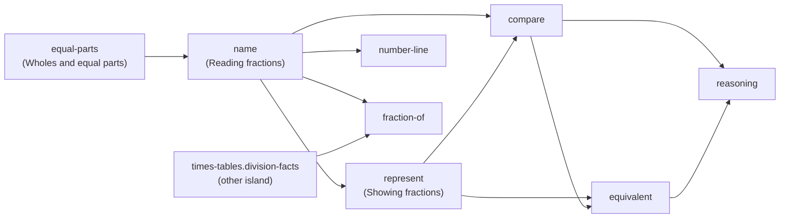

# CUR-002 — Learning progression model

| | |
|---|---|
| **Backlog item** | CUR-002: define the learning progression model (P0, R0) |
| **Status** | QA FAILED at `6050e3c` (D-014); corrected on 5 Nov and returned for independent retest (D-022) |
| **Date** | 4 November 2026; corrected 5 November 2026 ([correction report](../reports/R0-step2-correction-report.md)) |
| **Acceptance criteria** | <ol><li>Prerequisites form an explicit dependency graph.</li><li>Lessons progress from concrete or visual to abstract where appropriate.</li><li>Students are not advanced solely because they have clicked through a lesson.</li></ol> |
| **Deliverables** | <ul><li>This model.</li><li>The graph as validated data in `src/curriculum/prerequisites.ts`.</li><li>Checks in `src/curriculum/prerequisites.test.ts`.</li></ul> |
| **Scope (D-012)** | Defined and validated now; **not yet wired into the app**. R1 connects it to recommendations, explained locks and evidence-based completion (FR-011, MAST-001). |

---

## 1. Principles

1. **Evidence moves a child on, not clicks.**
   - Recommendations move on only when there is **independent evidence** the child can do it (§4).
   - Reaching a lesson's last screen is recorded as *visited*. Completing an activity is not evidence, and opening a
     lesson by hand is not evidence either.
   - Activity completion, lesson evidence and skill mastery are kept separate (§3).
2. **Prerequisites guide; they don't wall children in.**
   - The app recommends the next lesson whose prerequisites are secure.
   - A child may still open any lesson. A lesson whose prerequisites aren't secure shows an explained "best after…"
     notice that links to what's missing (FR-011 AC2).
   - Hard locks are kept for the independent check, which already waits for evidence (§5).
3. **Concrete → pictorial → abstract, inside each lesson.**
   - Every lesson shows a model (a picture, or the lab's manipulatives) before asking an independent question.
   - Across lessons, each new idea starts again from a picture. That is why phases don't rise steadily from lesson to
     lesson (§6).
4. **One wrong answer never permanently labels a child.**
   - The rules use the existing evidence windows and "possible / likely" wording (`src/engine/mastery.ts`).
   - A needs-review skill can always be recovered through a recheck.
5. **Two levels of graph.**
   - A **skill-level** graph for the R1 Fractions island.
   - An **island-level** graph for all 19 islands.
   - **Planned nodes** for Times Tables fluency (R2) and Mental Maths (R3), so later areas slot into the same structure.

## 2. The graphs (AC1)

The source of truth is `src/curriculum/prerequisites.ts`. The tables below are generated from it on 4 Nov. An arrow
means "should be secure before".

### 2.1 Fractions skill graph (R1)



| Skill | Lesson (order) | Prerequisites | Why |
|---|---|---|---|
| `fractions.equal-parts` | 1 · Wholes and equal parts | — | Entry point: a fraction needs a whole split into equal parts |
| `fractions.name` | 2 · Numerator and denominator | equal-parts | You can only name parts once you know they're equal |
| `fractions.represent` | 3 · The Fraction Lab | name | Showing ⅗ needs the meaning of 3 and 5 |
| `fractions.compare` | 4 · Comparing fractions | name, represent | Comparing uses the same whole and drawn models |
| `fractions.equivalent` | 5 · Equivalent fractions | represent, compare | Equivalence means "the same amount", which builds on comparing |
| `fractions.number-line` | 6 · Fractions on a number line | name | A new representation of named fractions |
| `fractions.fraction-of` | 7 · Fractions of amounts | name, **times-tables.division-facts** | ¾ of 12 means sharing 12 into 4 equal groups: a division fact |
| `fractions.reasoning` | 8 · Explaining your thinking | compare, equivalent | Explanations and counterexamples rely on comparison and equivalence |

### 2.2 Island graph (all 19 islands)

`place-value` and `times-tables` are the entry points: they have no prerequisites.

| Island | Prerequisites |
|---|---|
| place-value | — (entry) |
| rounding | place-value |
| negative | place-value |
| add-subtract | place-value |
| times-tables | — (entry) |
| multiply-divide | place-value, times-tables |
| fractions | times-tables |
| fractions-2 | fractions, multiply-divide |
| decimals | place-value, fractions |
| percentages | decimals, fractions-2 |
| money | add-subtract |
| time | add-subtract |
| area-perimeter | add-subtract, times-tables |
| shapes-angles | add-subtract |
| coordinates | negative |
| charts-data | add-subtract, multiply-divide |
| ratio-algebra | multiply-divide, fractions-2 |
| problem-solving | add-subtract, multiply-divide, fractions |
| mock-exams | rounding, negative, multiply-divide, percentages, money, time, area-perimeter, shapes-angles, coordinates, charts-data, ratio-algebra, problem-solving |

Island edges summarise skill edges. For example, `fractions` depends on `times-tables` only through `fraction-of`, so a
child can start Fractions before the Times tables island. Lessons 1 to 6 have no times-table prerequisite.

**Times Tables and Fractions (Q-5, D-019):**
- The division-facts prerequisite gives a **"best after" recommendation, never a lock**. It applies only to fractions
  of quantities (`fraction-of`, lesson 7).
- The amounts lesson gives its own support in the lesson: sharing counters, and the counters picture that is already
  in it. A child who hasn't done Times tables can still succeed.
- A "best after" notice links only to an activity that exists: the Times tables island's division lesson, which is
  live as a preview. It **never** links to the planned Times Tables fluency area (`planned:tt-fluency`, R2) until that
  is built.
- Foundational Fractions (lessons 1–6) never depends on completing the whole Times tables island. Skill-level
graphs for the other islands are R4 work, alongside CUR-001.

### 2.3 Planned areas (R2, R3)

| Planned node | Release | Backlog | Prerequisites |
|---|---|---|---|
| `planned:tt-fluency`: Times Tables fluency, facts to 12 × 12 and MTC-style practice | R2 | TT-001 to TT-012 | times-tables |
| `planned:mm-additive`: bonds, partitioning, bridging, compensation | R3 | MM-003 | place-value, add-subtract |
| `planned:mm-multiplicative`: doubling, halving, factor and ×5/9/11/25 strategies | R3 | MM-004 to MM-006 | tt-fluency, multiply-divide |
| `planned:mm-fdp`: fraction, decimal and percentage shortcuts | R3 | MM-007 | percentages, mm-multiplicative |

**How this is checked** (`src/curriculum/prerequisites.test.ts`, run in CI):
- no cycles anywhere;
- every island and every Fractions skill is covered;
- every id is a real island, a real skill or a planned area;
- Times Tables and Mental Maths are present as planned areas;
- every Fractions prerequisite is taught in an earlier lesson.

## 3. What we record, and what it is used for

Four ideas are kept separate (DEF-024, D-015). They describe **kinds of evidence, not a fixed sequence**. Placement can
skip a lesson, and a later review result can send a child back.

| Idea | Meaning | Recorded from |
|---|---|---|
| **Activity completed** (*visited*) | The child reached the end of a lesson, finished the lab challenges or finished a practice session | The player. *Today this is the lesson's "completed" flag (`LessonPlayer.tsx`).* |
| **Supported evidence** | A right answer reached with help: after a hint, after a supported retry, or in a guided (faded) step | Each answer's attempts and hints (`ItemResult`) |
| **Independent evidence** | A right answer on the **first attempt**, with **no hint**, to a question whose answer was **not revealed** and is **not the worked example on screen** (§4.1) | Each answer's attempts and hints |
| **Skill mastery** | The skill's status in the engine: secure, passed check, mastered, needs review | `src/engine/mastery.ts` (owned by MAST-001) |

**Lesson evidence never awards skill mastery** (D-015). Passing a lesson's final questions gives the skill independent
evidence, which is one input to mastery. Mastery needs the further evidence MAST-001 defines (§4.3).

### 3.1 Skill statuses today (`src/engine/mastery.ts`)

| Status | Rule today (adjustable constants, owned by MAST-001) |
|---|---|
| not started | No evidence |
| developing | Some lesson or practice evidence, not yet secure |
| secure | At least `SECURE_MIN_EVIDENCE` (3) of the last `RECENT_WINDOW` (5) lesson or practice answers, averaging at least `SECURE_THRESHOLD` (0.75). Today's scoring: right first time without help = 1, right with help = ½, wrong = 0. |
| passed check | Every item in the latest independent check was right, but there isn't enough evidence for mastered |
| mastered | Secure, **and** at least `MASTERY_MIN_INDEPENDENT` (2) independent check items, all right |
| needs review | An item in the latest independent evidence was wrong. Practice alone can't clear it; a later recheck can. |

These numbers are today's engine settings, listed so the rules below can refer to them. They are **not** endorsed here as
the mastery standard; MAST-001 owns and may change them (§4.3).

### 3.2 Which state drives what

| Use | Driven by | Not by |
|---|---|---|
| **Recommendations** (what to do next) | Independent evidence per lesson, and skill status | Visits, manual navigation |
| **Prerequisite satisfied** ("best after" notices) | The prerequisite skill is secure, passed check or mastered, **or** placed out and not since marked needs review (§4.4) | Visits; supported evidence alone |
| **Island map labels** | "Visited" ticks show activity. "Ready for the big challenge" and skill badges show skill status. | — |
| **Activity rewards** (stars for finishing, streaks) | Activity completed. These reward effort and say nothing about mastery. | — |
| **Mastery rewards** (mastery badges, "mastered" labels) | Skill mastery only | Activity, lesson evidence alone |

This replaces the step-2 wording, where "stars and the island map use visited" could be read as the map showing mastery.

## 4. Evidence rules (AC3)

### 4.1 How each attempt counts

| What happened | Records | Counts as independent evidence? |
|---|---|---|
| Right first time, no hint, answer not revealed | Activity, independent evidence | **Yes** |
| Right after a hint | Activity, supported evidence | No |
| Right on a later attempt (a supported retry, with feedback or a diagnosis between) | Activity, supported evidence | No |
| Wrong, then the answer was revealed | Activity; a wrong result for the skill | No |
| An answer to the **revealed item** itself (for example "try it again" on the same question) | Activity, supported evidence | **No.** An answer to the revealed item cannot count as independent evidence. |
| Later, a **fresh** unassisted question on the same skill (a transfer item: new numbers or model, CUR-003 §2, rule 4) | Activity, and evidence by the rules above | **Yes**, if right first time with no hint. This is how a child who needed the reveal shows independence later. |
| A guided (faded) worked step | Activity, supported evidence | No |
| Opening any lesson by hand | Nothing | No |

Supported activity is always recorded. It is useful for parents and for recommendations, and it feeds "developing".

### 4.2 One independence contract for lessons (Q-1, D-015)

A lesson is **evidenced** when its evidence questions were all answered independently (§4.1). Its evidence questions
are:
- **in a short, single-skill lesson:** its final independent questions (today's `check` steps after the last model);
- **in a lesson that needs evidence for several skills:** a separate `mastery-check` step (CUR-003), with at least one
  question per skill.

Both kinds follow the same contract:
- no hints;
- the first attempt counts;
- items are new, not the worked example (CUR-003 §2, rule 4).

A lesson can also be evidenced by:
- **placement:** the warm-up placed the child out of it;
- **the skill already being secure or better,** from earlier practice.

Placement doesn't count once a later result says needs review (§4.4).

**The lab lesson** (Fractions' `lab`) has no question steps. Its activity is the lab challenges. It is evidenced by
independent evidence on `fractions.represent` from practice, under the same contract (§5.1).

Evidenced lessons drive recommendations. **They do not award mastery.**

### 4.3 Skill mastery (owned by MAST-001)

- Mastery comes from evidence across **varied examples**: different numbers, models and question kinds for the same
  skill.
- It includes at least one **transfer** item (a new context or representation) answered independently.
- It also needs an independent check (the island's big challenge or a recheck), which the engine already uses.
- How many varied and transfer items are needed is **not set here**. MAST-001 sets it and records it in the engine's
  constants. Until then the engine's current rule (§3.1) stays as it is, and this specification invents no new
  threshold.

### 4.4 Precedence

- A **later** needs-review result always takes precedence over an earlier placement exemption or an earlier evidenced
  lesson. The prerequisite is no longer satisfied, and recommendations route to practice and a recheck (§5).
- A later independent check that passes clears needs-review, as the engine does today.

### 4.5 What changes from today

Today's rule is "the last step reached = complete" (FR-011 AC3, MAST-001). It is replaced by the evidenced rule above.
The change is specified here and made in R1 (coupling K-5 in ARCH-001).

## 5. Choosing what comes next (R1 behaviour)

Pure and deterministic. It extends `recommendNext` in `src/engine/journey.ts`; it doesn't rewrite it.

```
1. Active recheck or assessment in progress              → resume it                          (unchanged)
2. A needs-review skill whose prerequisites are fine     → targeted practice, then a recheck
3. The first lesson, in island order, that isn't evidenced:
   a. its activity isn't completed yet                   → the lesson (or "best after" its first
                                                            unsatisfied prerequisite, §2)
   b. its activity is completed, but evidence is missing → targeted practice on that lesson's skill
                                                            (for the lab: fractions.represent, §5.1)
4. All lessons evidenced, practice milestone not met     → practice                           (unchanged milestone)
5. Milestone met                                         → the big challenge                  (locked until here)
6. Afterwards                                            → review / strengthen                (unchanged)
```

**No loop and no automatic progression.**
- Rule 3b sends a child whose activity is done but whose evidence is missing to **targeted practice**, not back into the
  same lesson.
- The recommendation moves to the next lesson only when that practice produces the qualifying evidence (§4.2).
- There is **no attempt limit** after which the child is moved on regardless.

### 5.1 The lab path (DEF-025)

| Situation | Next recommendation |
|---|---|
| Lab challenges finished, no independent evidence on `fractions.represent` | Targeted practice on `fractions.represent` (fresh items, first attempt counts) |
| That practice gives the qualifying independent evidence (§4.2) | The lab is evidenced → the next lesson (`comparing`) |
| An answer was assisted (hint or retry) or wrong | **Targeted support** (the remedy picture or a return to the lab's build-a-fraction challenge), then **a fresh independent question** on the same skill. The recommendation stays on represent practice. |
| The child opens `comparing` (or any lesson) by hand | Allowed: prerequisites are soft (principle 2). A "best after" notice explains what's missing. Opening it awards no evidence. |

**Acceptance scenario (planned R1 test, `TC-CUR-002.3.3`):**

```
Given  a learner who has finished the Fraction Lab challenges
  and  has no independent evidence on fractions.represent
When   the next activity is recommended
Then   it is fractions.represent practice, not the lab again and not "comparing"

Given  that learner answers a represent practice question after a hint
When   the next activity is recommended
Then   it is targeted support and then a fresh represent question, not "comparing", and the lab is not evidenced

Given  that learner then answers a fresh represent question right first time with no hint,
  and  the evidence policy (§4.2) is now met
When   the next activity is recommended
Then   it is the "comparing" lesson, and the lab is evidenced

Given  at any point the learner opens "comparing" by hand
Then   the lesson opens with a "best after" notice, and no evidence or mastery is recorded for the lab
```

### 5.2 Across islands

- An island is recommended when its island prerequisites are satisfied (§3.2).
- An island whose prerequisites aren't met shows "best after <island>" on the map but stays open (principle 2).
- This also fixes the ordering problem found in the audit, where `order` restarts in each world (DEF-013).

**Explained locks** (FR-011 AC2). Every "best after":
- names the missing skill in child language;
- says *why* (the "Why" column in §2.1);
- gives one button that goes to it, only if that activity exists (§2, Q-5).

## 6. Concrete → pictorial → abstract (AC2)

**Within each lesson,** a model comes first. Every Fractions lesson shows a picture or a lab before its first
independent check. The test "shows a picture or a lab before the first check in every Fractions lesson" verifies this
on all 8 lessons.

**Across lessons,** the phase labels (`Understand`, `Visualise`, `Explore`, `Practise`, `Explain`, `Apply`, `Master`)
describe a lesson's purpose, not a rising sequence (D-018):
- each new idea begins at a picture;
- the island as a whole moves from concrete (equal parts, shading) to more abstract (equivalence, number line, fractions
  of amounts, reasoning).

**Deviations found on 4 Nov, and the decisions of 5 Nov:**

| Lesson | Observation | Proposed treatment |
|---|---|---|
| `number-line` (Visualise) after three Explore lessons | Phase goes "down" | **Kept (Q-4, D-018).** Checked against the content on 5 Nov: it uses only equal parts and naming (lessons 1–2) to count gaps and name points. It needs no comparison or equivalence. A new representation starts visual again. |
| `reasoning` (Explain) after `amounts` (Apply) | Phase goes "down" | **Kept (Q-4, D-018).** Checked on 5 Nov: it uses naming (Tom's 1/4 mistake), comparison with same-sized bars ({2/8} < {1/2}) and the counterexample claims about denominators and numerators. All are taught in lessons 2, 4 and 5. It doesn't use fractions of amounts, so following `amounts` is safe. |
| `naming` | A check question comes **before** its worked examples | **Move it after the worked example in R1 (Q-2, D-016).** A question before teaching is allowed only as a labelled, optional prior-knowledge check with no consequence. |
| `lab` | No check step | Evidence comes from independent `fractions.represent` practice after the challenges (§4.2, §5.1). Today the lab produces no recorded evidence; that's R1. |

## 7. Year groups and entry points

The entry nodes are `place-value` and `times-tables` (islands), and `fractions.equal-parts` (skill). Choosing a start by
year group (PARENT-001) and mapping objectives to the national curriculum (CUR-001) are separate items. They add year
tags to these nodes; they don't change the graph's shape.

## 8. What R1 must do to make this real

**Already in place now:**
- the graph data;
- the checks;
- this specification.

**R1 work:**
- record activity and evidence separately per lesson (a versioned state change with a migration; ARCH-001 §5);
- classify each answer as independent or supported (§4.1). Revealed items and their retries are never independent;
- extend `recommendNext` as in §5, including rule 3b and the lab path (§5.1);
- apply the precedence rule (§4.4);
- show "best after" notices that link only to activities that exist (§2, Q-5);
- make map labels and rewards follow §3.2;
- add tests for each rule above, including the §5.1 acceptance scenario;
- MAST-001 sets the varied-example and transfer evidence needed for mastery (§4.3).

These are the FR-011 and MAST-001 implementation tasks.
