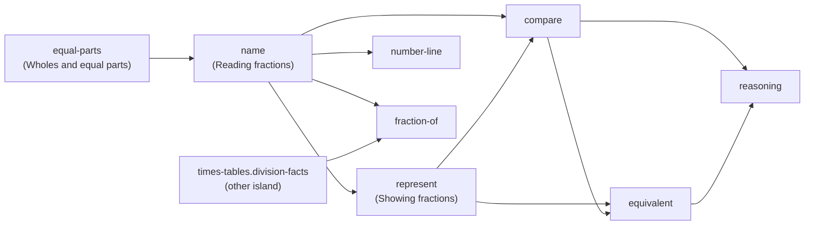

# CUR-002 — Learning progression model

| | |
|---|---|
| **Backlog item** | CUR-002: define the learning progression model (P0, R0) |
| **Status** | READY FOR QA, waiting for Product Owner and educational QA review |
| **Date** | 4 November 2026 |
| **Acceptance criteria** | <ol><li>Prerequisites form an explicit dependency graph.</li><li>Lessons progress from concrete or visual to abstract where appropriate.</li><li>Students are not advanced solely because they have clicked through a lesson.</li></ol> |
| **Deliverables** | <ul><li>This model.</li><li>The graph as validated data in `src/curriculum/prerequisites.ts`.</li><li>Checks in `src/curriculum/prerequisites.test.ts`.</li></ul> |
| **Scope (D-012)** | Defined and validated now; **not yet wired into the app**. R1 connects it to recommendations, explained locks and evidence-based completion (FR-011, MAST-001). |

---

## 1. Principles

1. **Evidence moves a child on, not clicks.**
   - A lesson or skill counts as done only when there is evidence the child can do it (§4).
   - Reaching a lesson's last screen is recorded as *visited*, which is not the same thing.
2. **Prerequisites guide; they don't wall children in.**
   - The app recommends the next lesson whose prerequisites are secure.
   - A child may still open any lesson. A lesson whose prerequisites aren't secure shows an explained "best after…"
     notice that links to what's missing (FR-011 AC2).
   - Hard locks are kept for the independent check, which already waits for evidence (§5).
3. **Concrete → pictorial → abstract, inside each lesson.**
   - Every lesson shows a model (a picture, or the lab's manipulatives) before asking an independent question.
   - Across lessons, each new idea starts again from a picture. That is why phases don't rise steadily from lesson to
     lesson (§6).
4. **One wrong answer never permanently labels a child.**
   - The rules use the existing evidence windows and "possible / likely" wording (`src/engine/mastery.ts`).
   - A needs-review skill can always be recovered through a recheck.
5. **Two levels of graph.**
   - A **skill-level** graph for the R1 Fractions island.
   - An **island-level** graph for all 19 islands.
   - **Planned nodes** for Times Tables fluency (R2) and Mental Maths (R3), so later areas slot into the same structure.

## 2. The graphs (AC1)

The source of truth is `src/curriculum/prerequisites.ts`. The tables below are generated from it on 4 Nov. An arrow
means "should be secure before".

### 2.1 Fractions skill graph (R1)



| Skill | Lesson (order) | Prerequisites | Why |
|---|---|---|---|
| `fractions.equal-parts` | 1 · Wholes and equal parts | — | Entry point: a fraction needs a whole split into equal parts |
| `fractions.name` | 2 · Numerator and denominator | equal-parts | You can only name parts once you know they're equal |
| `fractions.represent` | 3 · The Fraction Lab | name | Showing ⅗ needs the meaning of 3 and 5 |
| `fractions.compare` | 4 · Comparing fractions | name, represent | Comparing uses the same whole and drawn models |
| `fractions.equivalent` | 5 · Equivalent fractions | represent, compare | Equivalence means "the same amount", which builds on comparing |
| `fractions.number-line` | 6 · Fractions on a number line | name | A new representation of named fractions |
| `fractions.fraction-of` | 7 · Fractions of amounts | name, **times-tables.division-facts** | ¾ of 12 means sharing 12 into 4 equal groups: a division fact |
| `fractions.reasoning` | 8 · Explaining your thinking | compare, equivalent | Explanations and counterexamples rely on comparison and equivalence |

### 2.2 Island graph (all 19 islands)

`place-value` and `times-tables` are the entry points: they have no prerequisites.

| Island | Prerequisites |
|---|---|
| place-value | — (entry) |
| rounding | place-value |
| negative | place-value |
| add-subtract | place-value |
| times-tables | — (entry) |
| multiply-divide | place-value, times-tables |
| fractions | times-tables |
| fractions-2 | fractions, multiply-divide |
| decimals | place-value, fractions |
| percentages | decimals, fractions-2 |
| money | add-subtract |
| time | add-subtract |
| area-perimeter | add-subtract, times-tables |
| shapes-angles | add-subtract |
| coordinates | negative |
| charts-data | add-subtract, multiply-divide |
| ratio-algebra | multiply-divide, fractions-2 |
| problem-solving | add-subtract, multiply-divide, fractions |
| mock-exams | rounding, negative, multiply-divide, percentages, money, time, area-perimeter, shapes-angles, coordinates, charts-data, ratio-algebra, problem-solving |

Island edges summarise skill edges. For example, `fractions` depends on `times-tables` only through `fraction-of`, so a
child can start Fractions before the Times tables island. Lessons 1 to 6 have no times-table prerequisite. Skill-level
graphs for the other islands are R4 work, alongside CUR-001.

### 2.3 Planned areas (R2, R3)

| Planned node | Release | Backlog | Prerequisites |
|---|---|---|---|
| `planned:tt-fluency`: Times Tables fluency, facts to 12 × 12 and MTC-style practice | R2 | TT-001 to TT-012 | times-tables |
| `planned:mm-additive`: bonds, partitioning, bridging, compensation | R3 | MM-003 | place-value, add-subtract |
| `planned:mm-multiplicative`: doubling, halving, factor and ×5/9/11/25 strategies | R3 | MM-004 to MM-006 | tt-fluency, multiply-divide |
| `planned:mm-fdp`: fraction, decimal and percentage shortcuts | R3 | MM-007 | percentages, mm-multiplicative |

**How this is checked** (`src/curriculum/prerequisites.test.ts`, run in CI):
- no cycles anywhere;
- every island and every Fractions skill is covered;
- every id is a real island, a real skill or a planned area;
- Times Tables and Mental Maths are present as planned areas;
- every Fractions prerequisite is taught in an earlier lesson.

## 3. Child states

These reuse the existing engine statuses (`src/engine/mastery.ts`). The progression rules sit on top of them.

| Status | Rule today (constants in `mastery.ts`) |
|---|---|
| not started | No evidence |
| developing | Some lesson or practice evidence, not yet secure |
| **secure** | At least `SECURE_MIN_EVIDENCE` (3) of the last 5 lesson/practice answers, averaging at least `SECURE_THRESHOLD` (0.75). Scoring: right first time without help = 1, right with help = ½, wrong = 0. |
| passed check | Every item in the latest independent check was right, but there isn't enough evidence for "mastered" |
| **mastered** | Secure, **and** at least `MASTERY_MIN_INDEPENDENT` (2) independent items, all right |
| needs review | An item in the latest independent evidence was wrong. Practice alone can't clear it; a later recheck can. |

A prerequisite counts as **satisfied** when its skill is secure, passed check or mastered, **or** when the warm-up placed
the child out of that skill's lesson (the existing placement rules).

## 4. Evidence rules (AC3)

**Lesson states:**
- **Visited:** the child reached the last step. *Today this is recorded as "completed" (`LessonPlayer.tsx`).*
- **Evidenced:** any one of these is true:
  - every check question in the lesson was answered correctly within the allowed attempts, **without the answer being
    revealed**; or
  - for a lesson with no check step (Fractions' `lab`), all of the lesson's lab challenges are completed, *and* its skill
    has at least 1 correct practice answer; or
  - the warm-up placed the child out of the lesson; or
  - the lesson's skill is already secure.

**Which state counts for what:**
- Stars, the island map and "you've seen this" all use **visited**.
- Recommendations, prerequisite satisfaction and the "ready for the big challenge" milestone use **evidenced** and skill
  status.

**What happens when the evidence is missing:**
- A lesson that is visited but not evidenced is offered again as *"practise this first"* before the next lesson.
- **Recheck:** a needs-review skill sends its dependants back. The next recommendation becomes the needs-review
  prerequisite (practice, then a recheck) before any lesson that depends on it.

This replaces today's rule, "the last step reached = complete", which FR-011 AC3 and MAST-001 call out. The change is
specified here and made in R1 (coupling K-5 in ARCH-001).

## 5. Choosing what comes next (R1 behaviour)

Pure and deterministic. It extends `recommendNext` in `src/engine/journey.ts`; it doesn't rewrite it.

```
1. Active recheck or assessment in progress           → resume it            (unchanged)
2. A needs-review skill whose prerequisites are fine  → practise it, then recheck
3. The first lesson, in island order, that is not evidenced:
     prerequisites satisfied                          → recommend it
     prerequisites not satisfied                      → recommend the first unsatisfied prerequisite
                                                         (its lesson, or practice if visited) with "best after …"
4. All lessons evidenced, practice milestone not met  → practice              (unchanged milestone)
5. Milestone met                                      → the big challenge     (hard-locked until here)
6. Afterwards                                         → review / strengthen   (unchanged)
```

**Across islands:**
- An island is recommended when its island prerequisites are satisfied, meaning the relevant skills are secure or
  placed out.
- An island whose prerequisites aren't met shows "best after <island>" on the map but stays open (principle 2).
- This also fixes the ordering problem found in the audit, where `order` restarts in each world (DEF-013).

**Explained locks** (FR-011 AC2). Every "best after" names the missing skill in child language, says *why* (the "Why"
column in §2.1), and gives one button that goes to it.

## 6. Concrete → pictorial → abstract (AC2)

**Within each lesson,** a model comes first. Every Fractions lesson shows a picture or a lab before its first
independent check. The test "shows a picture or a lab before the first check in every Fractions lesson" verifies this
on all 8 lessons.

**Across lessons,** the phase labels (`Understand`, `Visualise`, `Explore`, `Practise`, `Explain`, `Apply`, `Master`)
describe a lesson's job, not a strict ladder:
- each new idea begins at a picture;
- the island as a whole moves from concrete (equal parts, shading) to more abstract (equivalence, number line, fractions
  of amounts, reasoning).

**Deviations on 4 Nov, for educational QA to confirm or reject:**

| Lesson | Observation | Proposed treatment |
|---|---|---|
| `number-line` (Visualise) after three Explore lessons | Phase goes "down" | Intended: a new representation starts visual again. Keep. |
| `reasoning` (Explain) after `amounts` (Apply) | Phase goes "down" | Intended: reasoning about earlier ideas. Keep, but educational QA to confirm the order. |
| `naming` | A check question comes **before** its worked examples | Template deviation (CUR-003). Move the check after the worked examples in R1, unless educational QA prefers a quick early check. |
| `lab` | No check step | Evidence comes from lab challenges plus practice (§4). The lab still produces no recorded evidence today; that's a gap for R1. |

## 7. Year groups and entry points

The entry nodes are `place-value` and `times-tables` (islands), and `fractions.equal-parts` (skill). Choosing a start by
year group (PARENT-001) and mapping objectives to the national curriculum (CUR-001) are separate items. They add year
tags to these nodes; they don't change the graph's shape.

## 8. What R1 must do to make this real

**Already in place now:**
- the graph data;
- the checks;
- this specification.

**R1 work:**
- add `lessonState: visited | evidenced` to per-island progress (a versioned state change with a migration; ARCH-001 §5);
- record check outcomes per lesson;
- extend `recommendNext` as in §5;
- show "best after" notices;
- make the island map use evidence;
- add tests for each rule above.

These are the FR-011 and MAST-001 implementation tasks.
